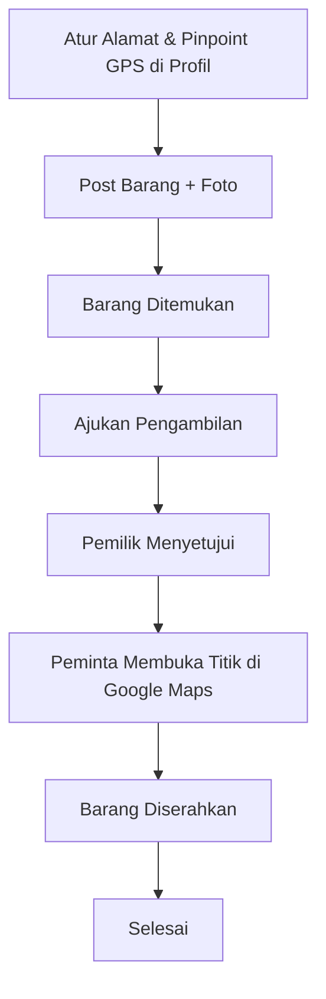
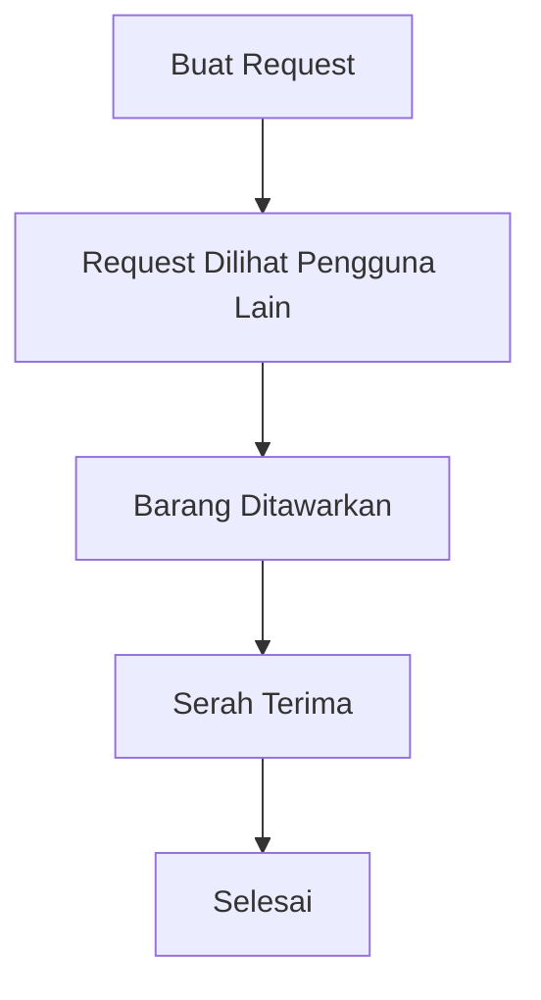

# ♻️ PakaiLagi

> **Berbagi barang yang masih layak pakai, agar dapat digunakan kembali oleh mereka yang membutuhkan.**

## About

**PakaiLagi** adalah platform berbagi barang secara gratis yang mempertemukan orang yang memiliki barang layak pakai dengan orang yang membutuhkannya.

PakaiLagi dapat digunakan oleh:

* Individu
* Rumah tangga
* Kantor
* Sekolah
* Organisasi
* Komunitas

Platform ini membantu memperpanjang masa guna barang dengan mempertemukan **pemberi barang** dan **penerima barang** dalam proses berbagi yang sederhana.

## Problem

Banyak barang yang masih layak digunakan berhenti terpakai karena pemiliknya sudah tidak membutuhkannya. Di sisi lain, ada orang lain yang sedang membutuhkan barang tersebut.

Tanpa wadah yang tepat, barang yang sebenarnya masih bernilai guna dapat tersimpan begitu saja atau akhirnya dibuang.

## Solution

PakaiLagi menyediakan ruang untuk:

* Membagikan barang yang sudah tidak digunakan secara gratis.
* Menemukan barang yang sedang dibutuhkan.
* Mengatur proses pengambilan dan serah terima antara pemberi dan penerima.
* Menunjukkan titik penjemputan secara presisi tanpa membuka alamat rumah ke semua orang.

Dengan begitu, barang yang masih layak pakai memiliki kesempatan untuk **dipakai kembali oleh orang lain**.

## How It Works

### Memberikan Barang



### Membutuhkan Barang (direncanakan)



## Pengambilan Barang

Setelah menemukan barang yang dibutuhkan, pengguna dapat mengajukan **Pengambilan**. Pemilik barang kemudian dapat melihat dan mengelola pengajuan tersebut.

Pemilik dapat:

* Melihat pengajuan.
* Menerima pengajuan.
* Menolak pengajuan.
* Memilih penerima apabila terdapat beberapa pengajuan.

Satu pengguna hanya dapat mengajukan satu kali untuk barang yang sama, dan hanya satu pengajuan yang dapat diterima per barang.

### Metode Pengambilan

| Metode | Penjelasan |
| --- | --- |
| **Antar ke Alamat** | Barang diantar ke alamat penerima, ongkir sesuai kesepakatan. |
| **Bertemu (COD)** | Pemberi dan penerima menentukan lokasi pertemuan yang disepakati bersama. |

## Lokasi & Privasi

Pemberi mendaftarkan alamat pengambilan sekali di **Profil → Alamat Pengambilan**:

1. Tekan **Pinpoint Lokasi di Peta (GPS)**. Peta langsung mencari posisi GPS dengan akurasi terbaik dan menampilkan lingkaran akurasinya.
2. Geser peta sampai pin tepat di titik penjemputan.
3. Tekan **Pilih Titik Ini**. Alamat lengkap, kelurahan, dan kota terisi otomatis (Android/iOS).
4. Lengkapi nomor rumah atau RT/RW, lalu **Simpan**.

Setiap barang yang di-posting memakai alamat profil ini. Siapa yang melihat apa:

| Pengguna | Yang terlihat di Detail Barang |
| --- | --- |
| Pengguna umum | Kelurahan & kota, tombol **Lihat Area di Google Maps** |
| Pemilik barang | Alamat lengkap, peta mini, tombol **Buka Titik di Google Maps** |
| Peminta yang pengajuannya diterima | Alamat lengkap, peta mini, tombol **Buka Titik di Google Maps** |

Pembatasan ini ditegakkan oleh Firestore Security Rules di server ([`firestore.rules`](firestore.rules)).

## Features

| Fitur | Status |
| --- | --- |
| Login & daftar (tampilan) | ✅ UI tersedia; autentikasi email/password belum aktif |
| Profil pengguna | ✅ |
| Alamat pengambilan dengan pinpoint GPS | ✅ |
| Tambah barang dengan foto (kamera/galeri) | ✅ |
| Hapus barang | ✅ |
| Kategori, pencarian, filter | ✅ |
| Detail barang | ✅ |
| Ajukan pengambilan & pilih metode | ✅ |
| Terima / tolak pengajuan | ✅ |
| Buka lokasi penjemputan di Google Maps | ✅ |
| Notifikasi aktivitas | ✅ |
| Riwayat aktivitas (pengajuan & barang saya) | ✅ |
| Mode offline (cache Firestore) | ✅ |
| Mode gelap | ✅ |
| Edit barang | 🚧 Direncanakan |
| Tandai serah terima selesai (`COMPLETED`) | 🚧 Direncanakan |
| Request barang yang dicari | 🚧 Direncanakan |
| Chat pemberi & penerima | 🚧 Tampilan prototipe, belum tersimpan di server |

## Status Barang

| Status | Deskripsi |
| --- | --- |
| `available` | Barang tersedia dan dapat diajukan untuk diambil. |
| `reserved` | Salah satu pengajuan telah diterima; barang disiapkan untuk penerima. |
| `completed` | Proses serah terima barang telah selesai (belum dapat di-set dari aplikasi). |

## Categories

PakaiLagi mendukung berbagai jenis barang yang masih layak digunakan, seperti:

* 👕 Pakaian
* 📚 Buku
* 🪑 Furniture
* 📱 Elektronik
* 🍳 Peralatan Rumah Tangga
* 🧸 Mainan
* 🍼 Perlengkapan Bayi & Anak
* 🎒 Perlengkapan Sekolah
* 💼 Perlengkapan Kantor

## MVP

MVP berfokus pada core flow:

**Share → Find → Request → Approve → Handover**

Tiga *advanced feature* utama:

1. **Kamera & Media** (`image_picker`) — foto barang langsung dari kamera atau galeri.
2. **GPS & Lokasi** (`geolocator`, `geocoding`, `flutter_map`, `url_launcher`) — pinpoint presisi dan tombol Google Maps di Detail.
3. **Mode Offline** (Firestore Persistence) — katalog dan riwayat tetap terbuka dari cache saat tidak ada internet.

Dokumentasi per pertemuan: [`p4/Report.md`](p4/Report.md), [`p5/P5_Local_Data_Persistence.md`](p5/P5_Local_Data_Persistence.md), [`p6/P6_Review_MVP.md`](p6/P6_Review_MVP.md), [`p7/P7_Review_MVP_Lengkap.md`](p7/P7_Review_MVP_Lengkap.md).

## Tech Stack

```text
Frontend   : Flutter (Dart), Material 3, Riverpod, go_router
Backend    : Firebase Authentication (Anonymous)
Database   : Cloud Firestore + Offline Persistence + Security Rules
Media      : image_picker (foto disimpan sebagai Base64 di Firestore)
Lokasi     : geolocator (GPS), geocoding (alamat dari koordinat),
             flutter_map + OpenStreetMap (peta pinpoint), url_launcher (Google Maps)
Deployment : Android APK (flutter build apk), Web (flutter build web)
```

## Menjalankan Proyek

```powershell
flutter pub get
flutter run                          # Android (disarankan untuk demo GPS & kamera)
flutter run -d chrome                # Web
firebase deploy --only firestore     # menerapkan rules & index Firestore
flutter analyze
flutter test
```

Catatan: di Web, peta dan GPS berfungsi di `localhost` atau HTTPS, tetapi alamat tidak terbaca otomatis dari titik peta sehingga diisi manual.

## Status

🚧 **In Development**

---

**PakaiLagi — Berbagi hari ini, digunakan kembali esok.**
